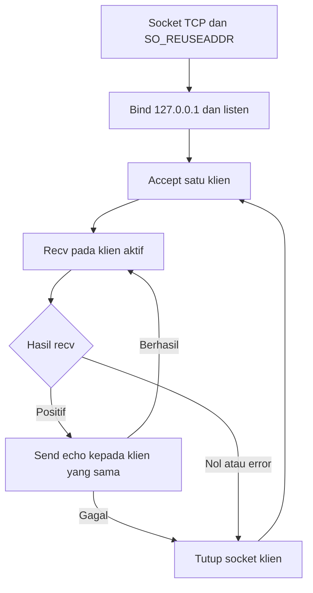
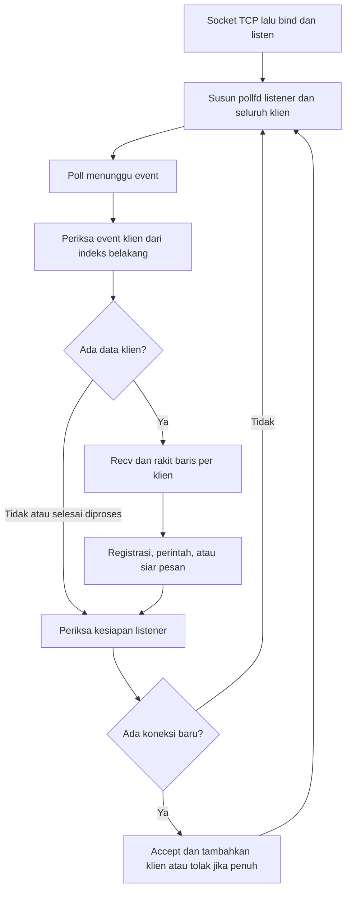
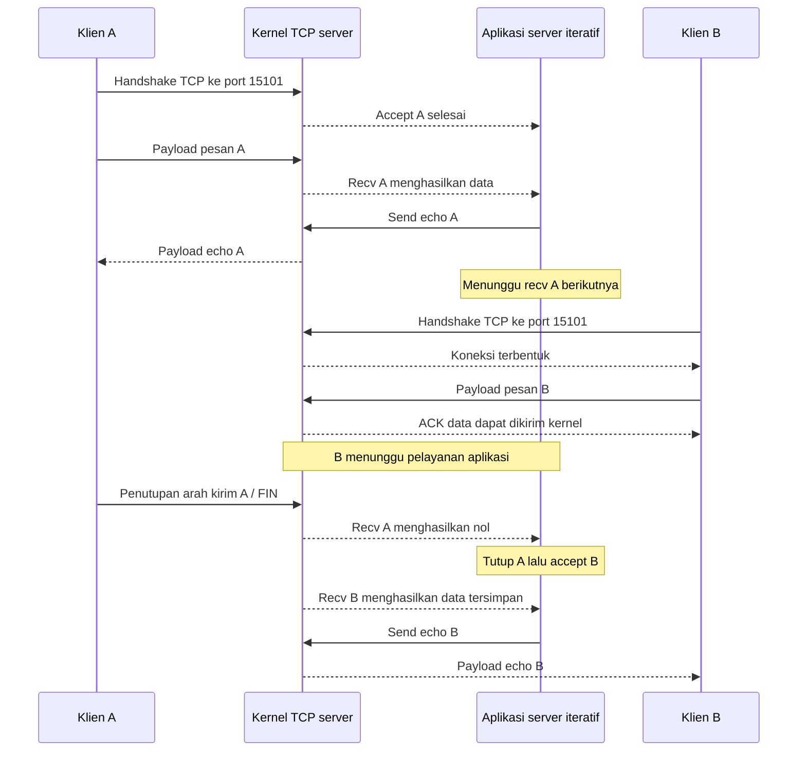
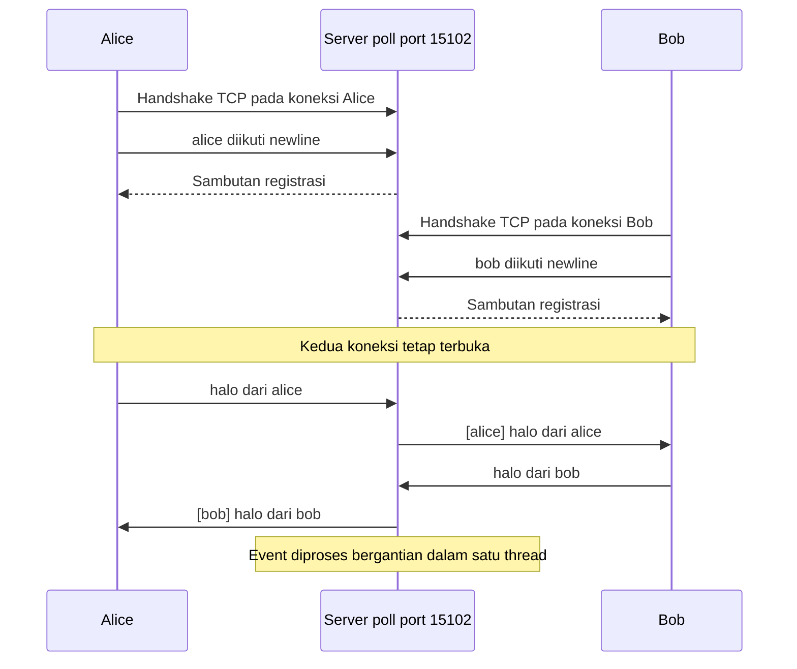

# Laporan Detail Hasil Uji Coba Modul 1 dan 2

**Topik:** server echo iteratif dan server chat dengan multiplexing I/O menggunakan `poll()`  
**Tanggal pengujian sumber:** 1 November 2026  
**Tanggal penyusunan laporan:** 2 November 2026

## 1. Tujuan, lingkungan, dan metode

Pengujian bertujuan menjelaskan pengaruh arsitektur server terhadap pelayanan lebih dari satu klien. Modul 1 menunjukkan penundaan layanan pada server iteratif, sedangkan modul 2 menunjukkan pertukaran pesan antarklien melalui satu thread dengan `poll()`. Laporan mencakup review program, hasil uji yang tersimpan, perbandingan kedua modul, serta panduan monitoring jaringan menggunakan Wireshark.

### 1.1 Lingkungan pengujian sumber

| Parameter | Nilai dan keterangan |
|---|---|
| Sistem operasi | Linux 6.17.0-41-generic, x86_64, glibc 2.42 |
| Bahasa dan build | C, target Makefile dengan `-Wall -Wextra -O2` |
| Transport | TCP/IPv4, `socket(AF_INET, SOCK_STREAM, 0)` |
| Alamat server dan klien | `127.0.0.1`, seluruh komunikasi berada pada mesin yang sama |
| Port modul 1 | `15101` |
| Port modul 2 | `15102` |

Port bawaan kedua program adalah `5000`, tetapi pada simulalsi menggunakan port di atas sebagai.

### 1.2 Sumber bukti dan cara membacanya

| Sumber | Pemakaian dalam laporan |
|---|---|
| [Log server modul 1](hasil_simulasi/s1_server.log) | Urutan penerimaan dan penutupan koneksi |
| [Log klien A](hasil_simulasi/m1_A.log) dan [klien B](hasil_simulasi/m1_B.log) | Waktu koneksi, pengiriman, dan penerimaan echo |
| [Log Alice](hasil_simulasi/m2_alice.log) dan [Bob](hasil_simulasi/m2_bob.log) | Registrasi berhasil dan pesan silang antarklien |
| [Panduan praktikum](Panduan_Simulasi_Praktikum.md) | Konteks pelaksanaan dan kriteria keberhasilan |

## 2. Review program modul 1: server echo iteratif

### 2.1 Komponen dan antarmuka

Sumber program adalah [server iteratif](kode_lab_chat_c_1/s1_server_iteratif.c) dan [klien echo](kode_lab_chat_c_1/s1_klien.c). Target kompilasinya bernama `s1_server` dan `s1_klien`.

```text
./s1_server [port]
./s1_klien [port] [label]
```

Label `A` atau `B` digunakan untuk tampilan log klien, bukan registrasi nama ke server. Server mengembalikan byte yang diterimanya kepada koneksi pengirim; modul ini bukan ruang chat dan tidak meneruskan pesan ke klien lain.

### 2.2 Alur server dan fungsi socket

Server membuat socket TCP, mengaktifkan `SO_REUSEADDR`, mengisi alamat IPv4 dengan `inet_pton()` dan port dengan `htons()`, lalu menjalankan `bind()` serta `listen(ls, 16)`. `SO_REUSEADDR` membantu penggunaan ulang alamat saat server dijalankan kembali; opsi ini tidak membuat pelayanan klien menjadi konkuren. Nilai backlog `16` adalah argumen antrean koneksi untuk kernel, bukan jumlah klien yang dilayani aplikasi secara bersamaan.

Setelah `accept()` memperoleh socket klien, server masuk ke loop `recv()` dengan buffer 512 byte. Setiap hasil pembacaan positif dikembalikan melalui `send()`. Ketika `recv()` menghasilkan nol, peer telah menutup arah pengirimannya; server keluar dari loop dan menutup socket klien. Setelah itu barulah server memanggil `accept()` berikutnya. Kesalahan `recv()` juga mengakhiri pelayanan koneksi tersebut.



Diagram menggambarkan jalur utama. Selama `recv()` menunggu data tambahan dari klien aktif, aplikasi belum kembali memeriksa koneksi lain melalui `accept()`.

### 2.3 Alur klien dan pencatatan waktu

Klien membuat socket, menjalankan `connect()`, membaca input menggunakan `fgets()`, mengirim satu potongan input, lalu menunggu satu hasil `recv()` sebelum membaca input berikutnya. EOF pada input membuat klien keluar dari loop dan memanggil `close()`. Pada uji otomatis, stdin A sengaja dibiarkan terbuka agar koneksinya tetap aktif.

Waktu log berasal dari `CLOCK_MONOTONIC`, dihitung relatif terhadap awal eksekusi masing-masing klien. Dengan demikian, `+1.4 ms` milik A dan `+2000.3 ms` milik B mempunyai titik awal berbeda. Angka `connect() sukses` juga merupakan waktu sejak awal program, bukan durasi syscall `connect()` yang diukur terpisah.

### 2.4 Evaluasi kode

Struktur server sederhana dan memudahkan pengamatan urutan `accept()`–`recv()`–`send()`–`close()`. Kelemahan utamanya adalah satu klien yang tetap terhubung tetapi tidak mengirim data dapat menahan pelayanan aplikasi kepada klien berikutnya.

Server dan klien hanya memanggil `send()` sekali untuk setiap potongan data, tanpa mengulang ketika jumlah byte terkirim lebih kecil daripada jumlah yang diminta. Pengiriman parsial dapat membuat sebagian data tidak terkirim. Klien juga menganggap satu `recv()` cukup untuk balasan satu kiriman, padahal TCP tidak mempertahankan batas pesan aplikasi. Risiko ini berasal dari review kode; kegagalan tersebut tidak teramati pada pesan pendek dalam pengujian yang tersedia.

## 3. Hasil uji modul 1

### 3.1 Skenario

Skrip menjalankan server pada port `15101`, membuka klien A, lalu mengirim `pesan A\n`. Setelah jeda sekitar 0,3 detik, skrip membuka B dan mengirim `pesan B\n`. Input A tetap terbuka. Skrip menunggu dua detik, menyimpan log B sebelum A ditutup, kemudian menutup stdin A dan menunggu kedua klien selesai.

### 3.2 Bukti log

Isi [log A](hasil_simulasi/m1_A.log):

```text
[A +   0.4 ms] connect() sukses
[A +   1.1 ms] kirim   : pesan A
[A +   1.4 ms] balasan : pesan A
[A +2304.3 ms] selesai
```

Isi [log B](hasil_simulasi/m1_B.log):

```text
[B +   0.6 ms] connect() sukses
[B +   1.5 ms] kirim   : pesan B
[B +2000.3 ms] balasan : pesan B
[B +2002.7 ms] selesai
```

Isi [log server](hasil_simulasi/s1_server.log):

```text
[server] listen di 127.0.0.1:15101 (iteratif)
[server] MASUK  127.0.0.1:35112
[server] terima 8 byte dari 127.0.0.1:35112
[server] KELUAR 127.0.0.1:35112
[server] MASUK  127.0.0.1:35120
[server] terima 8 byte dari 127.0.0.1:35120
[server] KELUAR 127.0.0.1:35120
```

### 3.3 Analisis hasil

| Indikator | Hasil teramati | Interpretasi |
|---|---|---|
| Echo A | Diterima pada `+1.4 ms` | A langsung dilayani sebagai koneksi aktif |
| Koneksi B | Berhasil pada `+0.6 ms` | Keberhasilan koneksi tidak berarti aplikasi server sudah menerima B dengan `accept()` |
| Pengiriman B | Dicatat pada `+1.5 ms` | Klien telah menjalankan pengiriman, tetapi belum menerima echo |
| Snapshot sebelum A ditutup | Hanya memuat koneksi dan pengiriman B | Pada titik pengamatan tersebut belum ada balasan aplikasi untuk B |
| Echo B | Diterima pada `+2000.3 ms` | B memperoleh pelayanan setelah A ditutup oleh skenario |
| Selisih catatan kirim–balasan B | `2000.3 − 1.5 = 1998.8 ms` | Interval berbasis log aplikasi, bukan RTT paket TCP |
| Urutan server | A masuk, A keluar, B masuk, B keluar | Konsisten dengan pelayanan iteratif |

**Status:** tujuan modul 1 tercapai pada skenario yang diuji, yaitu echo B tertunda selama A masih dipertahankan sebagai koneksi aktif.

## 4. Review program modul 2: server chat berbasis poll()

### 4.1 Komponen dan antarmuka

Sumber program adalah [server polling](kode_lab_chat_c_1/s2_server_poll.c) dan [klien chat](kode_lab_chat_c_1/s2_klien.c). Target kompilasinya bernama `s2_server` dan `s2_klien`.

```text
./s2_server [port]
./s2_klien [port] [nama_otomatis] [batas_hidup_detik]
```

Jika nama otomatis diberikan, klien mengirim `nama\n` setelah terhubung. Tanpa argumen nama, pengguna mengisi nama secara interaktif. Argumen batas hidup digunakan oleh simulasi agar klien berakhir setelah sekitar tiga detik; kode klien memeriksanya dalam loop dengan interval `poll()` 200 ms, sehingga bukan tenggat presisi keras.

### 4.2 Alur server

Server membuat listener dengan urutan socket, bind, dan listen yang serupa dengan modul 1. Perbedaannya terletak pada event loop: satu array `pollfd` berisi listener dan seluruh socket klien. `poll(..., -1)` menunggu sampai terdapat event, lalu aplikasi memproses descriptor yang siap.

Untuk socket klien yang memiliki `POLLIN`, server membaca data dan menambahkannya ke buffer klien terkait. Untuk listener yang siap, server memanggil `accept()` dan memasukkan koneksi baru ke daftar. Dalam kode ini, event klien lama diproses lebih dahulu, dari indeks belakang, kemudian event listener. Penghapusan klien memadatkan array dengan memindahkan elemen terakhir.



Error socket, EOF, atau permintaan keluar menyebabkan koneksi terkait ditutup. Server mengabaikan `SIGPIPE`, sehingga penulisan ke koneksi yang telah tertutup tidak langsung mematikan proses melalui sinyal tersebut.

### 4.3 State klien dan protokol aplikasi

Setiap klien memiliki descriptor, nama, status registrasi, alamat asal, buffer input 2048 byte, serta jumlah byte yang tersimpan. Batas daftar adalah 32 koneksi, termasuk koneksi yang belum menyelesaikan registrasi; kapasitas ini berasal dari konstanta kode dan belum diuji sampai penuh pada sesi Alice/Bob.

TCP menyediakan aliran byte. Fungsi `rakit_baris()` mencari `\n`, memproses seluruh baris utuh yang tersedia, dan menyimpan sisa baris yang belum lengkap. Jika newline didahului `\r`, karakter tersebut dihapus agar masukan CRLF dapat diterima. Buffer penuh tanpa newline menyebabkan pesan kesalahan dan penutupan koneksi.

| Masukan atau keadaan | Perilaku berdasarkan review kode | Status bukti sesi yang tersedia |
|---|---|---|
| Baris pertama | Menjadi nama pengguna; panjang 1–16 karakter, karakter alfanumerik menurut `isalnum()`, `_`, atau `-`; harus belum dipakai | Nama valid Alice/Bob berhasil; penolakan nama invalid/duplikat belum diuji |
| Registrasi berhasil | Mengirim sambutan ke pengguna dan notifikasi bergabung kepada pengguna lain yang terdaftar | Sambutan keduanya dan notifikasi Bob pada Alice terlihat |
| Pesan biasa setelah registrasi | Mengirim `[nama] pesan\n` ke pengguna lain yang terdaftar | Pesan silang Alice/Bob terlihat |
| `/who` | Mengirim daftar pengguna online, dengan penanda `(Anda)` pada peminta | Hanya terverifikasi melalui review kode |
| `/quit` | Menutup koneksi peminta dan memberi tahu pengguna lain | Hanya terverifikasi melalui review kode |
| Baris kosong setelah registrasi | Diabaikan | Hanya terverifikasi melalui review kode |
| Daftar 32 koneksi sudah penuh | Mengirim `!!! server penuh` lalu menutup koneksi tambahan | Hanya terverifikasi melalui review kode |

Nama adalah label pengguna, bukan autentikasi. Kedua modul menggunakan TCP plaintext tanpa TLS, sehingga pesan tidak memperoleh kerahasiaan dari program ini.

### 4.4 Alur klien dan evaluasi arsitektur

Klien modul 2 memakai `poll()` untuk memantau socket server dan stdin. Saat server mengirim data, klien mencetak hasil `recv()` tanpa harus menunggu pengguna selesai memasukkan pesan berikutnya. Ketika stdin mencapai EOF melalui jalur pembacaan input, klien dapat tetap mempertahankan koneksi; batas hidup atau penutupan server dapat mengakhiri sesi.

Server dan klien mengulang `send()` untuk menangani pengiriman parsial positif. Server juga merakit baris antarpembacaan, sehingga pemrosesan pesan tidak bergantung pada satu kali `recv()`. Ini memperbaiki keterbatasan framing modul 1.

Namun, socket tetap blocking. `poll()` membuat aplikasi menunggu kesiapan beberapa descriptor, bukan otomatis mengubahnya menjadi nonblocking. Fungsi `kirim_ke()` tetap mengirim sampai data selesai; jika penerima tidak membaca dan buffer kirim penuh, `send()` dapat menahan event loop. Klien juga memakai `fgets()` untuk stdin dan pengiriman blocking, sehingga penggunaan `poll()` tidak menjadikan seluruh operasi program nonblocking. Ketahanan terhadap pembaca lambat tidak dibuktikan oleh sesi ini.

## 5. Hasil uji modul 2

### 5.1 Skenario dan bukti

Skrip menjalankan server pada port `15102`, membuka `s2_klien` dengan nama otomatis `alice` dan `bob` serta batas hidup tiga detik. Setelah jeda 0,4 detik, kedua klien mengirim `halo dari alice\n` dan `halo dari bob\n`. Setelah jeda 0,4 detik berikutnya, skrip membaca status proses server dari `/proc/<pid>/status`.

Isi [log Alice](hasil_simulasi/m2_alice.log):

```text
*** ketik nama Anda lalu ENTER: *** selamat datang, alice
*** bob bergabung ke ruang chat
[bob] halo dari bob
```

Isi [log Bob](hasil_simulasi/m2_bob.log):

```text
*** ketik nama Anda lalu ENTER: *** selamat datang, bob
[alice] halo dari alice
```

Prompt dan sambutan tampak dalam baris yang sama karena prompt server tidak diakhiri newline. Tampilan tersebut tidak dapat digunakan untuk menghitung jumlah segmen TCP maupun jumlah panggilan `recv()`.

Snapshot `m2.server` dalam [ringkasan JSON](hasil_simulasi/ringkasan.json):

```json
{
  "VmSize": 2980,
  "VmRSS": 2036,
  "Threads": 1
}
```

### 5.2 Analisis hasil

| Indikator | Hasil teramati | Makna |
|---|---|---|
| Registrasi | Sambutan `alice` dan `bob` | Dua koneksi berhasil mencapai tahap aplikasi chat |
| Bob ke Alice | Alice menerima `[bob] halo dari bob` | Server meneruskan pesan ke koneksi Alice |
| Alice ke Bob | Bob menerima `[alice] halo dari alice` | Arah sebaliknya juga berfungsi |
| Thread server | `1` | Snapshot konsisten dengan event loop satu thread |
| VmSize | `2980 KiB` | Ukuran ruang alamat virtual proses pada snapshot |
| VmRSS | `2036 KiB` | Memori resident proses pada snapshot |

**Status:** tujuan utama modul 2 tercapai untuk dua klien, yaitu pesan silang berhasil dan snapshot server menunjukkan satu thread.

## 6. Perbedaan kedua modul

| Aspek | Modul 1: echo iteratif | Modul 2: chat dengan poll() |
|---|---|---|
| Tujuan layanan | Mengembalikan data ke pengirim | Meneruskan pesan ke pengguna lain |
| Transport dan alamat | TCP/IPv4 pada `127.0.0.1` | TCP/IPv4 pada `127.0.0.1` |
| Port uji | `15101` | `15102` |
| Pelayanan aplikasi | Satu koneksi dilayani sampai berakhir sebelum menerima berikutnya | Beberapa koneksi dipantau dan event yang siap diproses bergantian |
| Proses/thread | Alur satu proses, satu thread menurut kode | Alur satu proses, satu thread menurut kode; snapshot menunjukkan satu thread |
| Titik tunggu utama | `accept()` atau `recv()` klien aktif | `poll()` pada listener dan kumpulan socket; jalur kirim tetap dapat menunggu |
| Mode socket | Blocking | Blocking dengan multiplexing kesiapan I/O |
| Identitas | Label A/B hanya lokal pada log klien | Nama dikirim ke server dan divalidasi |
| Protokol pesan | Echo byte hasil `recv()` tanpa perakit pesan aplikasi | Teks dipisah newline, dengan buffer per klien |
| Tujuan balasan | Koneksi pengirim | Klien terdaftar selain pengirim untuk pesan biasa |
| Pengiriman parsial | Belum ditangani dengan loop | Ditangani dengan loop pengiriman |
| Perintah chat | Tidak tersedia | `/who` dan `/quit` tersedia menurut kode |
| Hasil utama | Echo B menunggu sampai A ditutup | Alice/Bob saling menerima pesan ketika koneksi masih aktif |
| Keterbatasan utama | Klien diam dapat menahan pelayanan klien berikutnya | Pembaca lambat dapat menahan `send()` dan seluruh event loop |
| Batas kesimpulan performa | Penundaan buatan sekitar dua detik pada satu skenario | Tidak ada pengukuran latensi atau throughput yang sebanding |

Perubahan utama adalah cara aplikasi menjadwalkan pelayanan koneksi. Dukungan TCP untuk membentuk lebih dari satu koneksi sudah ada pada modul 1, tetapi aplikasinya belum melayani koneksi tersebut secara konkuren. Modul 2 menambahkan state per klien dan pemantauan kesiapan I/O sehingga satu klien yang sedang diam pada sisi input tidak harus menahan pelayanan klien lain seperti pada loop `recv()` modul 1.

## 7. Diagram Koneksi

### 7.7 Diagram urutan ilustratif modul 1

Diagram memisahkan kernel TCP server dari aplikasi agar keberhasilan koneksi B tidak disamakan dengan pelayanan B. Panah handshake meringkas beberapa paket dan ACK data tidak digambar seluruhnya.



### 7.8 Diagram urutan ilustratif modul 2

Urutan registrasi dan pesan berikut dipilih untuk penjelasan. Setiap panah data dapat diwakili satu atau lebih segmen; ACK, prompt, dan notifikasi bergabung disederhanakan.



## 8. Kesimpulan dan batas hasil

Modul 1 berhasil menunjukkan pelayanan aplikasi yang sekuensial: B dapat terhubung dan mengirim, tetapi echo baru diterima setelah A ditutup. Waktu echo B `+2000.3 ms` konsisten dengan jeda dua detik yang sengaja diberikan skenario. Koneksi TCP yang berhasil dan ACK transport tidak setara dengan selesainya pelayanan aplikasi.

Modul 2 berhasil menunjukkan pertukaran pesan dua arah antara Alice dan Bob melalui server dengan snapshot satu thread. `poll()` memungkinkan aplikasi melayani beberapa koneksi aktif secara bergantian. Hasil ini membuktikan kemampuan fungsional untuk skenario dua klien, tanpa membuktikan throughput, latensi, kapasitas maksimum, atau ketahanan terhadap pembaca lambat. Jalur `send()` masih blocking.

Review kode mendukung penjelasan fitur registrasi, delimiter baris, `/who`, dan `/quit`, tetapi fitur yang tidak tampak pada log belum dinyatakan lulus uji. Data memori modul 2 hanya menggambarkan satu snapshot dan tidak menyediakan dasar perbandingan memori terhadap modul 1.

Monitoring Wireshark pada laporan ini berupa prosedur dan pola yang diharapkan. Verifikasi paket aktual masih memerlukan capture baru pada lingkungan Linux dengan izin yang sesuai. Tidak ada pcap modul lain, screenshot, nomor frame, atau statistik paket yang dipakai untuk menggantikan bukti yang belum tersedia.
